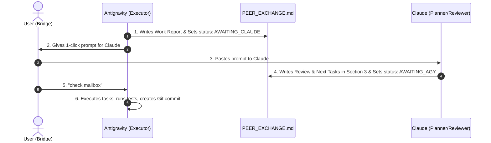

# Peer Exchange Template (Antigravity <-> Claude)

A lightweight, zero-dependency peer collaboration protocol and mailbox skill between **Antigravity (AGY)** and **Claude (CC)**.

---

## 🎯 Role Division

* 🧠 **Claude (Planner & Reviewer):**
  - Designs architecture, specifications, and milestones.
  - Reviews Antigravity's completed work, diffs, and test outputs.
  - Writes prioritized, numbered task checklists for Antigravity to execute.
  - *Does NOT modify project code directly.*

* 🛠️ **Antigravity (Sole Executor & Builder):**
  - Implements all code, tests, and configuration files.
  - Runs local builds and test suites (`pytest`, `npm test`, etc.).
  - Handles all Git staging and creates verified commits once tests pass.
  - Reports status, commit hashes, and verification numbers to the mailbox.

---

## 🚀 How to Use in Any Project

### Option A: 1-Click Automated Setup
From PowerShell inside this template folder, run:
```powershell
.\install.ps1 -Target "C:\Users\USER\Desktop\Code\your-project-name"
```
Or double-click `install.bat` and paste your project's folder path.

### Option B: Manual Setup (Drag & Drop)
To add this to any new or existing project:
1. Copy the `.agents` folder into your project's root:
   ```text
   <your-project>/
   └── .agents/
       └── skills/
           └── peer-exchange/
               └── SKILL.md
   ```
2. Copy `PEER_EXCHANGE.md` into your project's root:
   ```text
   <your-project>/
   └── PEER_EXCHANGE.md
   ```

---

## 🔄 The Collaboration Loop



### 1. Claude's 1-Click Prompt
When Antigravity finishes a turn, copy and paste this into Claude:
```text
Please inspect `PEER_EXCHANGE.md`. Review Section 1 & Section 2, fill out Section 3 with your critique, verdict, and numbered task list for Antigravity, and set `status: AWAITING_AGY` in the frontmatter.
```

### 2. Antigravity's Trigger
When Claude finishes writing in `PEER_EXCHANGE.md`, come back to Antigravity and say:
```text
check mailbox
```
*(or "Claude replied")*

---

## 📁 Template Contents
* `.agents/skills/peer-exchange/SKILL.md` — The Antigravity skill instructions.
* `PEER_EXCHANGE.md` — The starter mailbox file.
* `install.ps1` — PowerShell installer script.
* `install.bat` — Windows Batch installer script.
