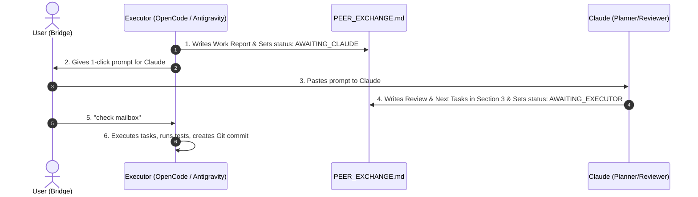

# Peer Exchange Template (OpenCode / Antigravity <-> Claude)

A lightweight, zero-dependency peer collaboration protocol and mailbox skill between an **Executor** — **OpenCode (OC)** or **Antigravity (AGY)**, fully interchangeable — and **Claude (CC)**.

---

## 🎯 Role Division

* 🧠 **Claude (Planner & Reviewer):**
  - Designs architecture, specifications, and milestones.
  - Reviews the Executor's completed work, diffs, and test outputs.
  - Writes prioritized, numbered task checklists for the Executor to execute.
  - Performs its own research, decision-making, and verification on critical matters; does not delegate these to the Executor.
  - Commands the Executor to use a project-local virtual environment for any dependency work; never global installs.
  - Requires the Executor to stop and report failures verbatim rather than assume or retry silently.
  - *Does NOT modify project code directly.*

* 🛠️ **The Executor — OpenCode *or* Antigravity (Sole Executor & Builder):**
  - Implements all code, tests, and configuration files.
  - Runs local builds and test suites (`pytest`, `npm test`, etc.).
  - Handles all Git staging and creates verified commits once tests pass.
  - Reports status, commit hashes, and verification numbers to the mailbox.
  - Both executors use the **exact same** protocol and mailbox file — only the `executor:` field in the frontmatter differs.

---

## 🚀 How to Use in Any Project

### Option A: 1-Click Automated Setup
From PowerShell inside this template folder, run:
```powershell
.\install.ps1 -Target "C:\Users\USER\Desktop\Code\your-project-name"
```
Or double-click `install.bat` and paste your project's folder path.

Add `-Global` to also install the skill for every project on this machine:
```powershell
.\install.ps1 -Target "C:\Users\USER\Desktop\Code\your-project-name" -Global
```
This copies the skill to `~/.config/opencode/skills/` (OpenCode) and `~/.claude/skills/` (Claude Code).

### Option B: Manual Setup (Drag & Drop)
To add this to any new or existing project:
1. Copy the `.agents` folder into your project's root:
   ```text
   <your-project>/
   └── .agents/
       └── skills/
           └── peer-exchange/
               └── SKILL.md
   ```
2. Copy `PEER_EXCHANGE.md` into your project's root:
   ```text
   <your-project>/
   └── PEER_EXCHANGE.md
   ```

> 📍 **Why `.agents/skills/`?** It is the shared agent-skill standard, so a single copy is picked up by **OpenCode**, **Antigravity**, and **Claude Code** alike. OpenCode also loads it from `.opencode/skills/peer-exchange/SKILL.md` if you prefer that layout.

---

## 🔄 The Collaboration Loop



### 1. Claude's 1-Click Prompt
When the Executor finishes a turn, copy and paste this into Claude:
```text
Please inspect `PEER_EXCHANGE.md`. Review Section 1 & Section 2, fill out Section 3 with your critique, verdict, and numbered task list for the executor, and set `status: AWAITING_EXECUTOR` in the frontmatter.
```

### 2. The Executor's Trigger
When Claude finishes writing in `PEER_EXCHANGE.md`, come back to the Executor and say:
```text
check mailbox
```
*(or "Claude replied")*

In OpenCode you can also trigger the skill explicitly with `/peer-exchange`.

---

## 📁 Template Contents
* `.agents/skills/peer-exchange/SKILL.md` — The Executor skill instructions (shared by OpenCode, Antigravity, and Claude Code).
* `PEER_EXCHANGE.md` — The starter mailbox file.
* `install.ps1` — PowerShell installer script.
* `install.bat` — Windows Batch installer script.
